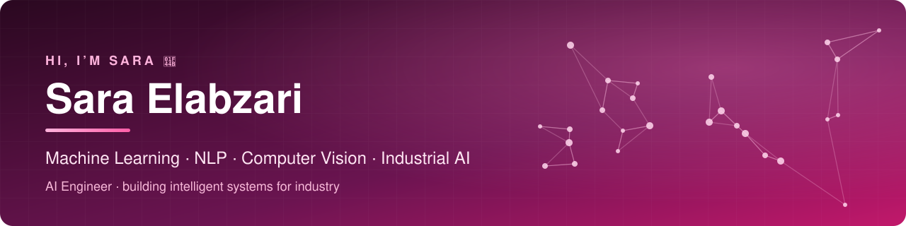

### AI Engineer · Machine Learning · NLP · Computer Vision · Industrial AI

I build end-to-end AI systems that cover the data pipeline, the model and evaluation, and the dashboard or web app, with tests and documentation. My focus is **industrial AI**: predictive maintenance, process and energy forecasting, and intelligent automation for plants and infrastructure.

- 🏭 Industrial AI: sensor analytics, remaining-useful-life prediction, load forecasting
- 🗣️ NLP & speech: Whisper transcription, multilingual summarization, retrieval chatbots
- 👁️ Computer vision: transfer learning, OCR, real-time detection
- 🌐 Web: designed and built a bilingual (EN/AR) corporate website with a careers platform

### 🚀 Featured work

| Project | Highlights |
|---|---|
| 🌐 [**ASEC Automation website**](https://www.asecautomation.com) · [code](https://github.com/Asec-automation/asec-website) | Corporate website I designed and developed end to end. React + TypeScript, prerendered 46 pages, English & Arabic, careers platform with CV uploads and an HR admin inbox (Cloudflare Worker + KV), CSP security, deployed with GitHub Actions + Pages |
| [**AI Engineering Portfolio**](https://github.com/Saraelabzari/Sara-AI-Engineering-Portfolio) | 14 tested Python projects across industrial AI, ML, NLP and computer vision, with CI on every push |
| [Predictive Maintenance — RUL](https://github.com/Saraelabzari/Sara-AI-Engineering-Portfolio/tree/main/projects/predictive-maintenance-rul) | Fleet health dashboard, train/test split by machine, RUL MAE 4.2 vs 36.8 for the baseline |
| [Energy Load Forecasting](https://github.com/Saraelabzari/Sara-AI-Engineering-Portfolio/tree/main/projects/energy-load-forecasting) | Gradient boosting that beats the seasonal-naive baseline, MAPE 2.2 % |
| [Speech-to-Text & Summarizer](https://github.com/Saraelabzari/Sara-AI-Engineering-Portfolio/tree/main/projects/multilingual-speech-to-text-summarizer) | Whisper + Transformers in a Streamlit app |

### 🧰 Tech stack

### 📫 Connect

